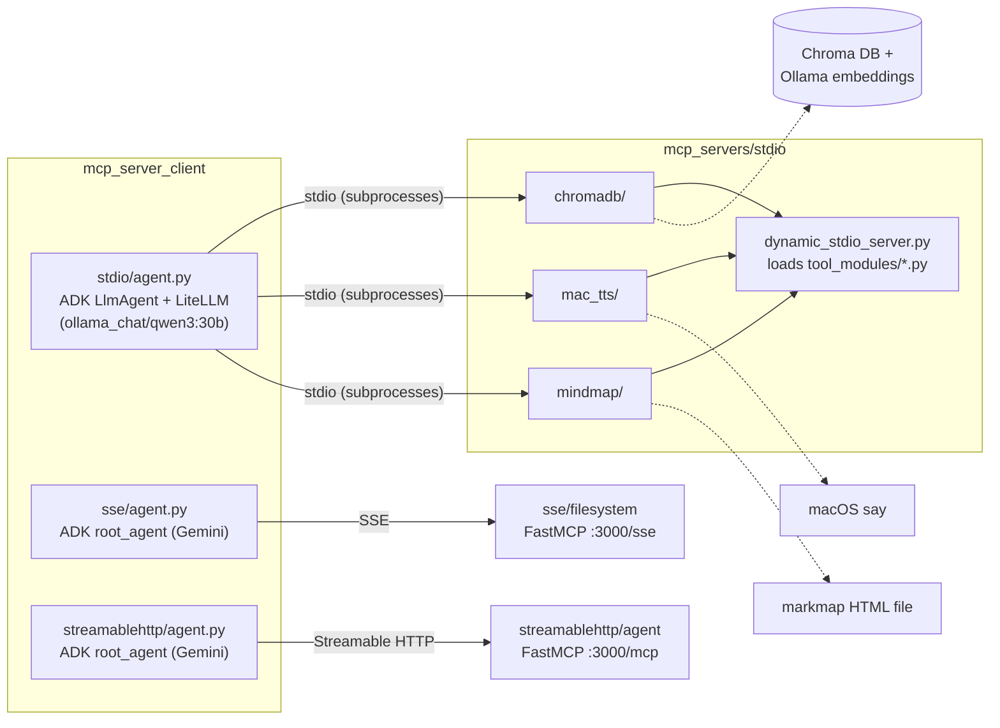
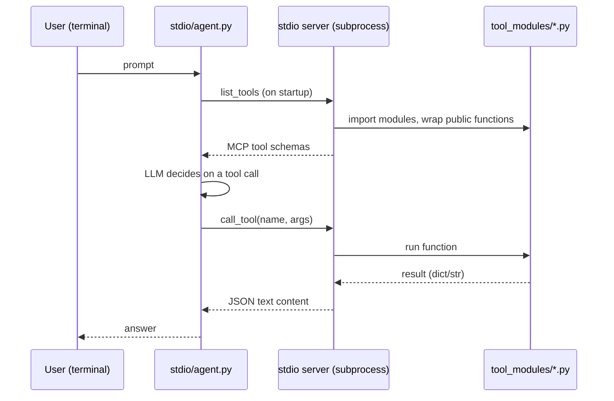

# MCP Server Framework

Python examples of Model Context Protocol (MCP) servers and Google ADK agent clients over the three MCP transports: `stdio`, `sse` and `streamable-http`.

## Overview

This repository is a playground for building MCP tool servers and wiring them into LLM agents built with the
[Google Agent Development Kit (ADK)](https://google.github.io/adk-docs/). Its main idea is a **dynamic stdio server**:
drop a Python module with plain functions into a `tool_modules/` folder and every public function is exposed as an MCP
tool, with its schema derived from the signature and docstring. It also includes minimal FastMCP filesystem servers for
the SSE and Streamable HTTP transports and matching ADK agents.

It is aimed at developers who want a small, readable reference for MCP transports and for turning ordinary Python
functions into MCP tools.

## Features

- **Shared dynamic stdio runtime** (`mcp_servers/stdio/dynamic_stdio_server.py`): scans `tool_modules/*.py`, wraps each
  public function in an ADK `FunctionTool`, converts it to an MCP tool schema and serves `list_tools` / `call_tool` over
  stdio. Tool results are returned as JSON text; exceptions are returned as `{"error": ...}`.
- **Three stdio tool servers** built on that runtime:
  - `chromadb` — `retrieve_documents(query, k)`: similarity search on a local Chroma collection
    (`example_collection` in `./chroma_langchain_db`) using Ollama `nomic-embed-text` embeddings.
  - `mac_tts` — `text_to_speech_mac(text, voice, output_file_path)`: speaks text or writes an audio file with the macOS
    `say` command.
  - `mindmap` — `convert_markdown_to_html(markdown_content, title, output_filename)`: writes an interactive
    [markmap](https://markmap.js.org/) HTML mind map from Markdown.
- **Filesystem server** with FastMCP exposing `read_file`, `list_directory` and `get_cwd`, in an SSE variant and a
  Streamable HTTP variant (both on `localhost:3000`).
- **ADK clients**:
  - `stdio` — interactive terminal chat agent that launches all three stdio servers as subprocesses, lists the
    discovered tools and their schemas, and supports `clear` / `exit`. Uses a local Ollama model through LiteLLM.
  - `sse` and `streamablehttp` — `root_agent` definitions (Gemini 2.0 Flash) that connect to the filesystem server.
- A template wrapper (`stdio_dynamic_tool_server_template.py`) for creating new stdio servers.

## Architecture



Sequence for a stdio tool call:



## Requirements

- Python 3.9+ (minimum supported by `google-adk`).
- Dependencies in `requirements.txt` (pinned: `google-adk==1.2.1`, `google-genai==1.18.0`, `mcp==1.9.2`,
  `litellm==1.72.1`, `python-dotenv==1.1.0`, plus LangChain/Chroma packages and optional extras).
- [Ollama](https://ollama.com/) running locally for the stdio client model (`qwen3:30b`) and for the Chroma
  embeddings (`nomic-embed-text`).
- macOS for the `mac_tts` server (it calls `say`).
- A Gemini API key for the `sse` and `streamablehttp` agents.

## Installation and quick start

```bash
git clone https://github.com/Lapeyus/mcp_server_framework.git
cd mcp_server_framework
python -m venv .venv
source .venv/bin/activate
pip install -r requirements.txt

ollama pull qwen3:30b
ollama pull nomic-embed-text

# Interactive agent that starts the three stdio servers itself:
python -m mcp_server_client.stdio.agent
```

## Usage

### Stdio servers

The stdio client launches these automatically. To run one on its own (it will wait for an MCP client on stdin/stdout):

```bash
python mcp_servers/stdio/chromadb/stdio_dynamic_tool_server.py
python mcp_servers/stdio/mac_tts/stdio_dynamic_tool_server.py
python mcp_servers/stdio/mindmap/stdio_dynamic_tool_server.py
```

### Adding a tool

1. Create `mcp_servers/stdio/<name>/tool_modules/<module>.py` with typed, documented public functions (names not
   starting with `_`).
2. Copy `mcp_servers/stdio/stdio_dynamic_tool_server_template.py` to
   `mcp_servers/stdio/<name>/stdio_dynamic_tool_server.py`.
3. Add an entry to `ACTIVE_SERVERS` in `mcp_server_client/stdio/agent.py`.

Discovery rules are documented in `mcp_servers/stdio/STDIO_DYNAMIC_TOOL_SERVER.md`.

### SSE and Streamable HTTP

```bash
# SSE filesystem server -> http://localhost:3000/sse
python mcp_servers/sse/filesystem/filesystem_server.py

# Streamable HTTP filesystem server -> http://localhost:3000/mcp
python mcp_servers/streamablehttp/agent/server.py
```

`mcp_servers/streamablehttp/agent/filesystem_server.py` is a compatibility alias for `server.py`. Both servers use port
3000, so run one at a time.

`mcp_server_client/sse/agent.py` and `mcp_server_client/streamablehttp/agent.py` only define a module-level `root_agent`
for ADK tooling; they contain no chat loop, so `python -m mcp_server_client.sse.agent` imports the module and exits.
Running them interactively requires an ADK runner such as `adk run` / `adk web` (not scripted in this repo).

## Repository structure

```text
mcp_server_framework/
├── mcp_servers/
│   ├── stdio/
│   │   ├── dynamic_stdio_server.py              # Shared runtime: tool discovery + MCP stdio server
│   │   ├── stdio_dynamic_tool_server_template.py# Wrapper template for new servers
│   │   ├── STDIO_DYNAMIC_TOOL_SERVER.md         # Discovery rules
│   │   ├── chromadb/   (wrapper + tool_modules/chroma.py)
│   │   ├── mac_tts/    (wrapper + tool_modules/tts.py)
│   │   └── mindmap/    (wrapper + tool_modules/markmapper.py)
│   ├── sse/filesystem/filesystem_server.py      # FastMCP over SSE
│   └── streamablehttp/agent/
│       ├── server.py                            # FastMCP over Streamable HTTP
│       └── filesystem_server.py                 # Alias of server.py
├── mcp_server_client/
│   ├── stdio/agent.py                           # Interactive ADK agent (Ollama via LiteLLM)
│   ├── sse/agent.py                             # ADK root_agent for the SSE server
│   └── streamablehttp/agent.py                  # ADK root_agent for the Streamable HTTP server
├── requirements.txt
└── PRE_PUSH_CHECKLIST.md                        # Manual checks before pushing
```

## Configuration

- The stdio client calls `load_dotenv()`, so a local `.env` file can hold provider keys. Keep it out of git.
- Gemini agents read the standard ADK/Google GenAI variables (for example `GOOGLE_API_KEY`); the code itself does not
  reference any variable by name.
- Model names, server lists, ports and the Chroma collection/path are constants in the source files
  (`MODEL` and `ACTIVE_SERVERS` in `mcp_server_client/stdio/agent.py`, `FastMCP(..., port=3000)` in the servers,
  `_get_vector_store()` in `chroma.py`).
- Generated files not meant for git: `./chroma_langchain_db/`, mind map HTML files, TTS audio files.

## Tests

There is no automated test suite. The only scripted check is the syntax check from `PRE_PUSH_CHECKLIST.md`:

```bash
python -m compileall -q mcp_servers mcp_server_client
```

It passed on 2026-10-27.

## Project status

Experimental reference project. Started June 2025; last commit February 2026.

## Known limitations

- The filesystem servers read any path the process can access; the "allowed directory" text in the SSE/HTTP agent
  instructions is not enforced by the server.
- The SSE and Streamable HTTP agents filter for tools such as `read_multiple_files` or `directory_tree` that the bundled
  server does not provide; only `read_file` and `list_directory` match (`get_cwd` is filtered out).
- The Chroma server expects an already-populated collection; the repo has no ingestion script.
- `mac_tts` only works on macOS.
- `requirements.txt` mixes pinned core packages with unpinned extras; only `langchain-chroma` and `langchain-ollama`
  are imported by the code. `langchain-community`, `langchain-experimental`, `langchain-openai`, `pyzotero`,
  `langchain-zotero-retriever`, `mcp-server-fetch` and `beautifulsoup4` are not used by anything in the repo.
- No LICENSE file is present; some files carry Apache 2.0 headers from Google ADK samples.
